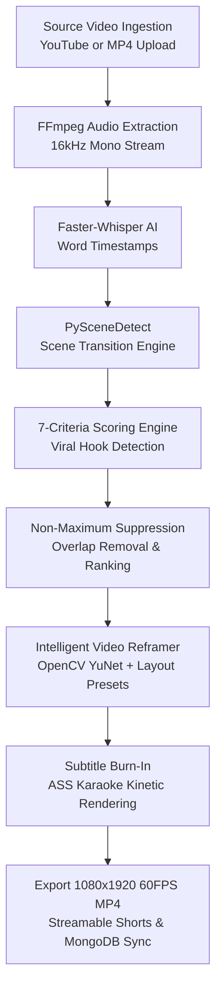

# ClipGenius AI 🎬⚡

> **Autonomous AI Video Clipping & Reframing Engine for YouTube Shorts, Instagram Reels, and TikTok.**  
> Transform long-form videos and podcasts into high-converting, viral 9:16 vertical shorts in seconds. 100% Free & Open-Source — zero paid third-party API subscriptions required.

---

## 🌟 Overview

**ClipGenius AI** is an end-to-end studio application inspired by leading commercial platforms like OpusClip, Klap, and Wayin.ai. Powered by local AI models, computer vision, and high-performance FFmpeg rendering, ClipGenius ingests full-length YouTube videos or direct uploads, transcribes spoken speech with word-level timestamps, detects high-virality narrative moments, dynamically tracks and reframes speakers into 9:16 vertical video, and burns kinetic animated captions.

---

## 🚀 Key Features

### 1. 📥 Omnichannel Video Ingestion
- **Direct Cloud URL Clipping (Zero-Download)**: Paste any accessible MP4/WebM URL (e.g. cloud storage, CDN, direct HTTP video). ClipGenius inspects the stream with FFprobe, extracts only the 16kHz audio stream over HTTP for speech transcription, and slices/reframes final 9:16 clips via HTTP Range requests without ever downloading the original long-form video to local computer storage. Protected by strict SSRF guards against private IP ranges and loopback requests.
- **YouTube & Web Link Import**: Instant streaming download using `yt-dlp` supporting YouTube videos, shorts, podcasts, Twitch VODs, and direct MP4/WebM URLs.
- **Direct Local Upload**: Drag-and-drop ingestion with instant client-side validation and metadata extraction via `ffprobe` (resolution, FPS, bitrate, audio channels).

### 2. 🎙️ Faster-Whisper Speech Transcription
- **Word-Level Timestamps**: High-precision phonetic alignment for exact word-by-word subtitle rendering.
- **Offline & Private**: Runs quantized local Whisper models (`tiny`, `base`, `small`) on CPU/GPU with zero external API fees or quota limits.
- **Automatic Language & Speech Detection**: Differentiates spoken dialogue from ambient noise and game soundtracks.

### 3. 🧠 7-Criteria Moment Scoring & Viral Hook Detection
Analyzes narrative structure, emotional spikes, visual cuts (via PySceneDetect), and speech pacing to score candidate clips on a 0–100 scale:
- **Hook Strength (20 pts)**: Opening 5-second retention power and intrigue.
- **Interesting Content (20 pts)**: Informational density and narrative momentum.
- **Emotional Engagement (15 pts)**: Tone variation, reactions, and conversational energy.
- **Information Value (15 pts)**: Standalone value delivered to the viewer.
- **Story Completeness (15 pts)**: Clear beginning, climax, and takeaway.
- **Ending Quality (10 pts)**: Resolves without dangling mid-sentence cuts.
- **Audio-Visual Quality (5 pts)**: Scene continuity and acoustic clarity.

### 4. 📐 Wayin.ai-Inspired Layout Presets (No Distortion)
- **GTA 6 Full (`full_screen`)**: 100% vertical full-screen action framing centered on gameplay/reaction.
- **GTA 6 Top (`streamer_split`)**: Streamer Facecam Top 40% + Gameplay Bottom 60% with synchronized split framing.
- **GTA 6 Cam (`streamer_bottom`)**: Gameplay Top 60% + Streamer Facecam Bottom 40%.
- **GTA 6 Fit (`blur_fit`)**: Original 16:9 widescreen frame centered with ambient blurred background filling the 9:16 canvas.
- **Adventure PiP (`streamer_pip`)**: Full 9:16 vertical action with floating camera picture-in-picture.
- **Smart Face Follow (`smart_auto`)**: OpenCV YuNet neural network face detector smoothly pans to keep the active speaker centered.

### 5. ✨ Kinetic Animated Subtitles (Karaoke Styles)
- **Bold Yellow**: MrBeast / TikTok creator style with punchy yellow keywords and black drop shadow.
- **Minimal Clean**: Elegant crisp white subtitles with subtle outline.
- **Boxed Violet**: Modern purple highlight badge style.
- **Professional Podcast**: Subtle, polished captions for interviews.
- **No Captions**: Clean video cut with subtitles disabled.

### 6. ⚡ Studio Management & Live 9:16 Video Preview
- **Interactive 9:16 Preview Modal**: Watch vertical shorts directly in the dashboard with audio playback before downloading.
- **One-Click 1080p 60 FPS Export**: Hardware-accelerated H.264 CRF 19 visually lossless rendering.
- **One-Click Storage Manager**: Monitor disk usage and purge cached video files with a single click.

---

## 🛠️ Architecture & Tech Stack



### Frontend
- **Framework**: Next.js 16 (App Router, Turbopack)
- **UI Library**: React 19, Tailwind CSS
- **Icons**: Lucide React
- **HTTP Client**: Native Fetch with streaming polling

### Backend
- **Framework**: FastAPI (Python 3.12)
- **Database**: MongoDB (via Motor async driver)
- **Computer Vision**: OpenCV (`cv2.FaceDetectorYN` YuNet)
- **Scene Detection**: PySceneDetect
- **Speech-to-Text**: Faster-Whisper (CTranslate2)
- **Media Engine**: FFmpeg & FFprobe
- **Web Scraping**: yt-dlp

---

## 💻 Getting Started

### Prerequisites
- **Python 3.10+** (Python 3.12 recommended)
- **Node.js 18+** & **npm**
- **FFmpeg** installed and accessible in system `PATH`
  - macOS: `brew install ffmpeg`
  - Ubuntu/Debian: `sudo apt update && sudo apt install ffmpeg`
  - Windows: `choco install ffmpeg`
- **MongoDB** running locally on port `27017`

---

### Installation & Setup

#### 1. Clone the Repository
```bash
git clone https://github.com/aniruddh209/ClipGeniusAi.git
cd ClipGeniusAi
```

#### 2. Backend Setup
```bash
cd backend

# Create and activate virtual environment
python3 -m venv venv
source venv/bin/activate  # On Windows: .\venv\Scripts\activate

# Install dependencies
pip install --upgrade pip
pip install -r requirements.txt

# Start the FastAPI backend server (Port 8001)
uvicorn app.main:app --host 127.0.0.1 --port 8001 --reload
```

The backend API documentation will be available at:
- **Interactive Swagger Docs**: `http://127.0.0.1:8001/docs`
- **Health Check Endpoint**: `http://127.0.0.1:8001/api/v1/health`

#### 3. Frontend Setup
Open a new terminal window:
```bash
cd Frontend  # or frontend

# Install npm packages
npm install

# Start Next.js development server (Port 3001)
npm run dev -- -p 3001
```

Access the web dashboard in your browser:
- **URL**: `http://localhost:3001`

---

## 📁 Project Structure

```
ClipGeniusAi/
├── backend/
│   ├── app/
│   │   ├── api/v1/endpoints/
│   │   │   ├── clips.py           # 10-Step AI pipeline, candidate clips & batch cuts
│   │   │   ├── health.py          # System diagnostics & service health
│   │   │   ├── reframing.py       # Live framing preview & OpenCV reframe render
│   │   │   ├── subtitles.py       # Kinetic caption rendering & style customization
│   │   │   ├── transcription.py   # Faster-Whisper speech extraction
│   │   │   └── videos.py          # Video ingestion, yt-dlp & storage manager
│   │   ├── core/
│   │   │   ├── config.py          # App settings & storage directories
│   │   │   └── database.py        # Async Motor MongoDB connection
│   │   ├── models/                # Pydantic schemas for clips, reframing & subtitles
│   │   └── services/
│   │       ├── ai/
│   │       │   ├── clip_selector.py   # 7-Criteria Viral Moment Identification Engine
│   │       │   ├── transcription.py   # Faster-Whisper CTranslate2 pipeline
│   │       │   └── video_reframer.py  # OpenCV YuNet Face Tracking & Layout Filtergraph
│   │       └── video/
│   │           ├── ffmpeg_editor.py   # Frame-accurate cutting & audio sync
│   │           └── subtitle_renderer.py # ASS karaoke subtitle generation
│   ├── requirements.txt
│   └── uploads/ / generated-clips/
├── Frontend/
│   ├── src/
│   │   ├── app/
│   │   │   ├── dashboard/
│   │   │   │   ├── create/page.tsx    # Source ingestion, layout preset cards & parameters
│   │   │   │   └── projects/page.tsx  # Project gallery, storage cleaner & clip management
│   │   │   └── page.tsx               # Studio suite overview
│   │   ├── components/
│   │   │   └── video/
│   │   │       ├── ClipDetectionPanel.tsx   # Candidate clips grid & 9:16 preview modal
│   │   │       ├── PipelineProgressModal.tsx # Real-time pipeline step monitor
│   │   │       ├── ReframingStudio.tsx       # Live bounding-box framing adjustment
│   │   │       └── SubtitleEditor.tsx        # Word-level caption customization
│   │   └── lib/api.ts                 # Type-safe API client
│   ├── package.json
│   └── tailwind.config.ts
├── .gitignore
└── README.md
```

---

## ⚙️ Configuration & Environment Variables

Default settings run out-of-the-box with local defaults. You can optionally create a `backend/.env` file:

```env
PROJECT_NAME="ClipGenius AI"
MONGODB_URL="mongodb://localhost:27017"
DATABASE_NAME="clipgenius"
API_V1_STR="/api/v1"
CORS_ORIGINS=["http://localhost:3000","http://localhost:3001"]
WHISPER_MODEL="tiny"
```

---

## 🛡️ License

This project is licensed under the MIT License — see the [LICENSE](LICENSE) file for details.
